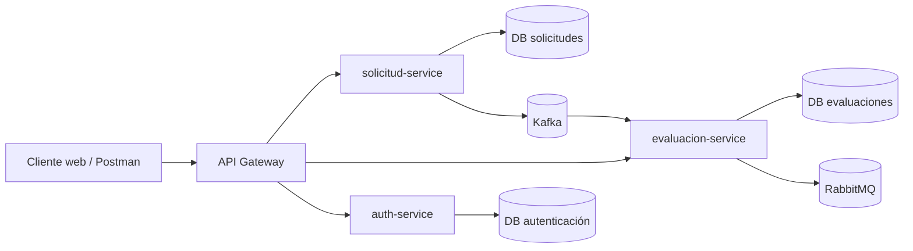
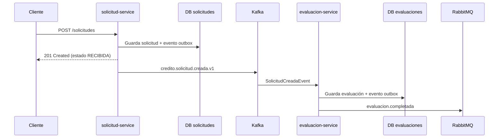
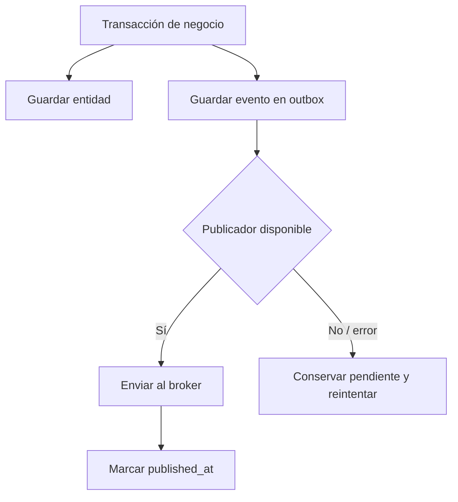

# Arquitectura de sistemas distribuidos — Sistema de crédito

## 1. Qué problema resuelve esta arquitectura

El sistema permite registrar solicitudes de crédito, evaluarlas y autenticar usuarios sin concentrar todas las responsabilidades en una sola aplicación ni en una sola base de datos.

En lugar de un monolito, cada capacidad de negocio se ejecuta como un servicio independiente. Esto permite desplegar, escalar y evolucionar la gestión de solicitudes, las evaluaciones y la identidad sin acoplarlas internamente.



## 2. Componentes y responsabilidades

| Componente | Rol dentro del sistema | Tipo de comunicación |
|---|---|---|
| API Gateway | Entrada única, enrutamiento HTTP y futuro punto de validación JWT. | HTTP síncrono. |
| solicitud-service | Crea y consulta solicitudes de crédito. | HTTP, PostgreSQL y Kafka. |
| evaluacion-service | Evalúa solicitudes cuando recibe un evento. | Kafka, PostgreSQL, RabbitMQ y HTTP. |
| auth-service | Gestiona cuentas, OAuth Google/GitHub, MFA y JWT. | HTTP, OAuth2 y base propia. |
| Kafka | Transfiere el hecho de negocio `SolicitudCreada`. | Eventos asíncronos. |
| RabbitMQ | Distribuye el hecho `EvaluacionCompletada` a futuros consumidores. | Eventos asíncronos. |
| PostgreSQL | Persistencia privada de solicitudes y evaluaciones. | Base por servicio. |

## 3. Comunicación síncrona y asíncrona

La arquitectura usa ambos estilos porque no todos los casos de uso tienen las mismas necesidades.

### Comunicación síncrona: HTTP

HTTP se usa cuando el cliente necesita una respuesta inmediata:

- `POST /solicitudes`: confirma que la solicitud fue recibida y guardada.
- `GET /solicitudes/{id}`: consulta su estado actual.
- `GET /evaluaciones/{solicitudId}`: consulta un resultado ya procesado.
- Endpoints `/auth/**`: registro, login, MFA e inicio de OAuth2.

El API Gateway evita que el cliente conozca la topología interna. El cliente llama a una sola URL pública y el gateway resuelve el servicio correspondiente.

### Comunicación asíncrona: eventos

La evaluación no se realiza dentro de la solicitud HTTP. El servicio de solicitudes publica un evento en Kafka y el servicio de evaluación lo procesa cuando esté disponible.



Este desacoplamiento permite que una caída temporal del servicio de evaluación no impida crear solicitudes. Las evaluaciones se recuperan cuando el consumidor vuelve a estar disponible.

## 4. Propiedad de los datos

Cualquier servicio es dueño de sus datos. No hay una base relacional común ni claves foráneas entre las bases de solicitudes y evaluaciones.

| Servicio | Datos que posee | No debe acceder directamente a |
|---|---|---|
| solicitud-service | Solicitudes y sus eventos de salida. | Tablas de evaluaciones o autenticación. |
| evaluacion-service | Evaluaciones y sus eventos de salida. | Tablas de solicitudes o autenticación. |
| auth-service | Usuarios, perfiles OAuth y MFA. | Tablas de solicitudes o evaluaciones. |

`evaluacion-service` conserva `solicitudId`, pero solo como referencia de correlación obtenida desde Kafka. Esa decisión evita que una operación de evaluación dependa de que la base de solicitudes esté disponible.

## 5. Consistencia eventual

Después de crear una solicitud existe una ventana breve donde:

```text
Solicitud:  RECIBIDA
Evaluación: todavía no disponible
```

No es un error: es consistencia eventual. El cliente debe consultar posteriormente `GET /evaluaciones/{solicitudId}`. Cuando la evaluación existe, devuelve la decisión aprobada o rechazada.

El beneficio es que el sistema puede seguir aceptando trabajo aunque el evaluador se procese más lentamente o se reinicie.

## 6. Fiabilidad con el patrón Outbox

Un riesgo habitual es guardar una solicitud y fallar justo antes de emitir su evento. En ese caso, la solicitud existiría pero nunca se evaluaría.

Para evitarlo, cada servicio mantiene una tabla `outbox_events` en su misma base:

1. En una única transacción, el servicio guarda el dato de negocio y el evento pendiente.
2. Un publicador programado busca eventos cuyo `published_at` es nulo.
3. El publicador los envía al broker.
4. Solo después de confirmar el envío actualiza `published_at`.



La entrega es *al menos una vez*: un mismo evento puede reenviarse. Por ello, `evaluacion-service` es idempotente y su campo `solicitud_id` es único.

## 7. Tolerancia a fallos

| Falla | Comportamiento esperado |
|---|---|
| Kafka no disponible al crear solicitud | La solicitud y el evento quedan en la DB; el publicador reintenta. |
| evaluacion-service detenido | Kafka conserva el evento hasta que el consumidor vuelva. |
| RabbitMQ no disponible | La evaluación queda guardada y su outbox conserva el evento pendiente. |
| Una evaluación recibe el mismo evento dos veces | La restricción única por solicitud evita duplicarla. |
| auth-service no disponible | Las operaciones de identidad fallan, pero no cambia la información de solicitudes o evaluaciones. |

Para producción conviene añadir reintentos con espera progresiva, *dead-letter queues*, métricas de eventos pendientes y alertas.

## 8. Escalabilidad

Los servicios se pueden escalar de manera diferente según su carga:

| Servicio | Motivo para escalar | Consideración |
|---|---|---|
| solicitud-service | Muchas peticiones de creación. | Las réplicas comparten su base y deben coordinar la publicación outbox. |
| evaluacion-service | Evaluaciones demoradas o gran volumen de eventos. | Kafka reparte particiones entre consumidores del mismo grupo. |
| auth-service | Picos de inicio de sesión/OAuth. | Debe usar una sesión compartida o una estrategia de estado compatible con múltiples réplicas durante OAuth. |
| API Gateway | Alto tráfico externo. | Debe ser sin estado y ubicarse detrás de un balanceador. |

## 9. Seguridad

El auth-service usa OAuth2 Authorization Code para Google y GitHub. Spring Security controla el parámetro `state` durante el flujo, con lo que reduce el riesgo de CSRF en los callbacks.

Después de autenticar al usuario, el servicio entrega JWT firmados con HS512. El cliente debe enviarlos en cada petición de negocio:

```http
Authorization: Bearer <access-token>
```

La arquitectura ya genera el token, pero la validación obligatoria del JWT en el gateway es la siguiente pieza necesaria. Hasta configurarla, enviar el token no restringe los endpoints de solicitudes y evaluaciones.

Buenas prácticas incluidas o previstas:

- Secretos de OAuth y JWT mediante variables de entorno, no en el repositorio.
- Contraseñas locales con BCrypt.
- MFA TOTP opcional.
- Perfiles OAuth únicos por proveedor e identidad externa.
- No persistir tokens de acceso de Google/GitHub.
- Próxima mejora: usar claves asimétricas/JWKS y rotar refresh tokens.

## 10. Despliegue local y operación

Docker Compose levanta servicios, bases y brokers. Los contenedores se conectan mediante nombres internos como `kafka`, `rabbitmq`, `solicitudes-db` y `evaluaciones-db`; el cliente usa el gateway en el puerto `8080`.

```powershell
docker compose up --build
```

Los endpoints Actuator permiten verificar disponibilidad:

```text
/actuator/health
/actuator/health/liveness
/actuator/health/readiness
```

## 11. Ventajas frente al monolito original

| Monolito | Arquitectura actual |
|---|---|
| Una aplicación concentra autenticación, solicitudes y evaluación. | Cada capacidad tiene un servicio con responsabilidad delimitada. |
| Una caída o despliegue afecta todo el sistema. | Los servicios se despliegan y recuperan de manera independiente. |
| La evaluación bloquea o acopla la creación. | Kafka permite procesarla en segundo plano. |
| Riesgo de base de datos compartida. | Cada servicio posee su propia persistencia. |
| Integraciones internas directas. | Eventos versionados y contratos explícitos. |

## 12. Próximos pasos recomendados

1. Convertir `authdb` a PostgreSQL en Docker Compose y gestionar esquemas con Flyway.
2. Validar JWT en API Gateway y propagar identidad/roles a los servicios.
3. Implementar renovación y revocación de refresh tokens.
4. Añadir DLQ, reintentos exponenciales y trazabilidad distribuida con un `correlationId`.
5. Definir política de escalado y bloqueo distribuido para publicadores outbox con múltiples réplicas.
6. Añadir pruebas de integración con Testcontainers para PostgreSQL, Kafka y RabbitMQ.
