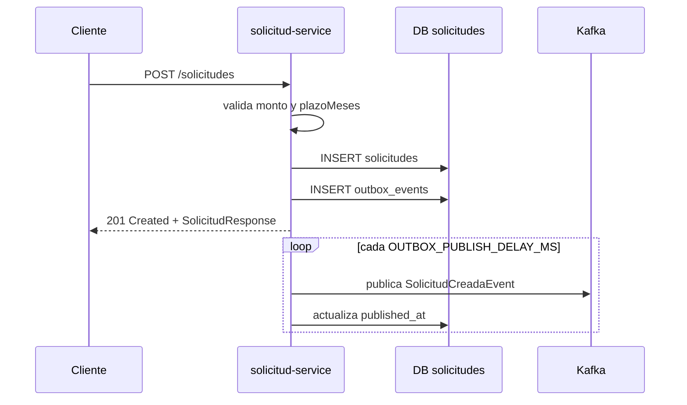

# Detalle de implementación — Sistema de crédito distribuido

## 1. Estructura del repositorio

El proyecto se organiza como un *multi-project build* de Gradle con Java 21 y Spring Boot 3.3.1.

```text
sistema-credito-distribuido/
├── contracts/                 # Contratos JSON compartidos y versionados
├── api-gateway/               # Punto de entrada HTTP, puerto 8080
├── solicitud-service/         # Gestión de solicitudes, puerto 8081
├── evaluacion-service/        # Evaluación asíncrona, puerto 8082
├── auth-service/              # Identidad, JWT, MFA y OAuth, puerto 8083
├── docker/Dockerfile           # Imagen parametrizada por servicio
└── docker-compose.yml          # Infraestructura y despliegue local
```

`settings.gradle` declara cada módulo y `build.gradle` raíz centraliza el repositorio Maven, el grupo, la versión y el *toolchain* Java 21.

## 2. Contratos entre servicios

El módulo `contracts` evita que los servicios compartan entidades JPA. Solo comparte DTOs inmutables (`record`) serializables a JSON:

| Contrato | Uso |
|---|---|
| `CrearSolicitudRequest` | Cuerpo del `POST /solicitudes`. |
| `SolicitudResponse` | Respuesta HTTP del servicio de solicitudes. |
| `SolicitudCreadaEvent` | Evento Kafka `credito.solicitud.creada.v1`. |
| `EvaluacionResponse` | Respuesta HTTP de consulta de evaluación. |
| `EvaluacionCompletadaEvent` | Evento RabbitMQ `evaluacion.completada`. |

Los contratos usan UUID como identificador de solicitud, `BigDecimal` para importes y `Instant` para tiempos de eventos.

## 3. API Gateway

El módulo `api-gateway` usa Spring Cloud Gateway reactivo. Atiende en el puerto `8080` y enruta sin duplicar lógica de negocio.

| Ruta pública | Servicio destino | URL interna Docker |
|---|---|---|
| `/solicitudes/**` | `solicitud-service` | `http://solicitud-service:8081` |
| `/evaluaciones/**` | `evaluacion-service` | `http://evaluacion-service:8082` |
| `/auth/**` | `auth-service` | `http://auth-service:8083` |

Las URL se parametrizan mediante `SOLICITUD_SERVICE_URL`, `EVALUACION_SERVICE_URL` y `AUTH_SERVICE_URL`. Así, fuera de Docker los valores por defecto apuntan a `localhost` y dentro de Docker a los nombres de servicio.

## 4. solicitud-service

### Responsabilidades

- Validar y crear solicitudes de crédito.
- Persistirlas en su base `solicitudes`.
- Registrar de forma atómica el evento de creación en la tabla outbox.
- Publicar posteriormente el evento en Kafka.

### Componentes

| Clase | Responsabilidad |
|---|---|
| `SolicitudController` | Expone `POST /solicitudes` y `GET /solicitudes/{id}`. |
| `SolicitudApplicationService` | Valida datos, crea la entidad y registra la outbox dentro de una transacción. |
| `SolicitudCredito` | Entidad JPA de negocio. |
| `SolicitudRepository` | Acceso JPA a solicitudes. |
| `OutboxEvent` y `OutboxEventRepository` | Registro durable de eventos pendientes. |
| `KafkaOutboxPublisher` | Tarea programada que publica lotes pendientes en Kafka. |

### Creación de una solicitud



Ejemplo de petición:

```http
POST /solicitudes
Content-Type: application/json

{
  "monto": 12000.00,
  "plazoMeses": 24
}
```

La respuesta tiene estado `RECIBIDA`. La evaluación no se ejecuta en la misma petición: es eventual y asíncrona.

## 5. evaluacion-service

### Responsabilidades

- Consumir el evento Kafka de una solicitud creada.
- Aplicar la política de crédito.
- Persistir la evaluación de forma idempotente.
- Publicar la evaluación completada a RabbitMQ desde su propia outbox.

### Componentes

| Clase | Responsabilidad |
|---|---|
| `SolicitudCreadaKafkaConsumer` | Escucha el tópico Kafka y deserializa `SolicitudCreadaEvent`. |
| `EvaluacionApplicationService` | Coordina idempotencia, política, persistencia y outbox. |
| `PoliticaEvaluacionCredito` | Aprueba si `monto <= 50000` y `plazoMeses <= 60`. |
| `EvaluacionCredito` | Entidad JPA; `solicitudId` es único. |
| `RabbitOutboxPublisher` | Publica los eventos pendientes a RabbitMQ. |
| `RabbitConfiguration` | Declara exchange, cola y binding durables. |
| `EvaluacionController` | Expone `GET /evaluaciones/{solicitudId}`. |

### Idempotencia

Kafka puede entregar un evento más de una vez. Antes de evaluar, el servicio busca una evaluación por `solicitudId`. El índice único de esa columna impide persistir dos evaluaciones para la misma solicitud.

La publicación de salida usa:

```text
Exchange:    credito.evaluaciones.v1
Routing key: evaluacion.completada
Queue:       credito.evaluacion.completada.v1
```

## 6. auth-service

El módulo de autenticación combina cuentas locales, MFA TOTP, JWT propio y proveedores Google/GitHub.

### Endpoints

| Método | Ruta | Propósito |
|---|---|---|
| `POST` | `/auth/register` | Registra una cuenta local con contraseña BCrypt. |
| `POST` | `/auth/login` | Autentica una cuenta local y devuelve JWT. |
| `GET` | `/auth/oauth/google` | Inicia el flujo OAuth2 de Google. |
| `GET` | `/auth/oauth/github` | Inicia el flujo OAuth2 de GitHub. |
| `POST` | `/auth/mfa/setup/{userId}` | Genera secreto y QR TOTP. |
| `POST` | `/auth/mfa/verify` | Verifica el código TOTP y activa MFA. |

El servicio configura `server.servlet.context-path: /auth`, por lo que los endpoints OAuth estándar de Spring Security quedan bajo el mismo prefijo:

```text
/auth/oauth2/authorization/google
/auth/oauth2/authorization/github
/auth/login/oauth2/code/google
/auth/login/oauth2/code/github
```

### OAuth2 de Google y GitHub

La integración usa `spring-boot-starter-oauth2-client`, no llamadas manuales al endpoint de tokens.

1. El cliente abre `/auth/oauth/google` o `/auth/oauth/github`.
2. `AuthController` redirige a `/oauth2/authorization/{provider}`.
3. Spring Security genera y guarda `state`, redirige al proveedor y canjea el `code` en el callback.
4. `OAuth2ProfileMapper` normaliza la identidad externa.
5. Para GitHub, consulta `/user/emails` con el token temporal y elige un correo verificado.
6. `RegisterOAuthUseCase` localiza o crea la cuenta y el perfil OAuth.
7. `OAuthLoginSuccessHandler` entrega los JWT internos en una respuesta JSON sin almacenar tokens de Google/GitHub.

El perfil OAuth se habilita con:

```text
SPRING_PROFILES_ACTIVE=oauth
GOOGLE_CLIENT_ID=...
GOOGLE_CLIENT_SECRET=...
GITHUB_CLIENT_ID=...
GITHUB_CLIENT_SECRET=...
JWT_SECRET=...
```

`JWT_SECRET` debe aportar al menos 64 bytes, pues `JwtAdapter` firma con HS512. Nunca debe quedar escrito en `application.yml` ni versionado en Git.

### Protección contra errores de vinculación

- Los perfiles OAuth son únicos por `(provider, external_id)`.
- Si ya existe una cuenta local con el mismo correo, el servicio no la vincula automáticamente a una identidad externa. Devuelve conflicto y evita una toma de cuenta por asociación implícita.
- Los tokens de acceso y refresh de Google/GitHub no se persisten.

## 7. Infraestructura local con Docker Compose

`docker-compose.yml` levanta:

| Contenedor | Uso | Puerto expuesto |
|---|---|---|
| `zookeeper` | Coordinación de Kafka | 2181 |
| `kafka` | Eventos de solicitudes | 9092 |
| `rabbitmq` | Eventos de evaluaciones | 5672, 15672 |
| `solicitudes-db` | PostgreSQL de solicitudes | interno |
| `evaluaciones-db` | PostgreSQL de evaluaciones | interno |
| `solicitud-service` | API de solicitudes | 8081 |
| `evaluacion-service` | API de evaluaciones | 8082 |
| `auth-service` | API de identidad | 8083 |
| `api-gateway` | Entrada pública | 8080 |

Ejecutar el sistema:

```powershell
docker compose up --build
```

## 8. Observabilidad y salud

Todos los servicios incluyen Spring Boot Actuator. Los endpoints de salud son:

```text
/actuator/health
/actuator/health/liveness
/actuator/health/readiness
```

Al acceder mediante el gateway, se conserva el prefijo de la ruta del servicio correspondiente.

## 9. Seguridad pendiente para cerrar el circuito

El auth-service ya emite JWT, pero el gateway y los demás servicios deben validar el encabezado `Authorization: Bearer <token>` antes de considerar protegidos los endpoints de negocio.

La siguiente iteración debería añadir:

1. Un `JwtDecoder` compatible con HS512 o, preferiblemente, claves asimétricas y JWKS.
2. Spring Security Resource Server en el gateway.
3. Reglas de autorización por rol o *scope*.
4. Un endpoint de renovación `POST /auth/refresh` con rotación y revocación de refresh tokens.
5. Cifrado en reposo para `mfa_secret` y migraciones versionadas con Flyway o Liquibase.
