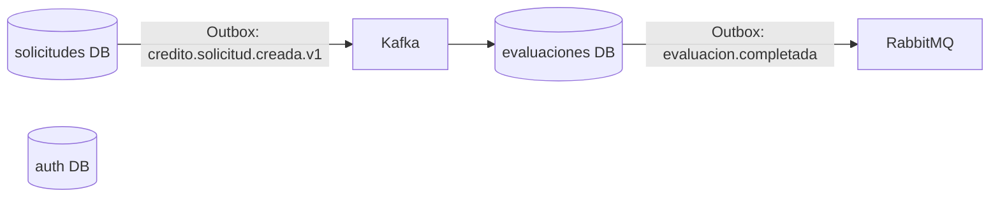
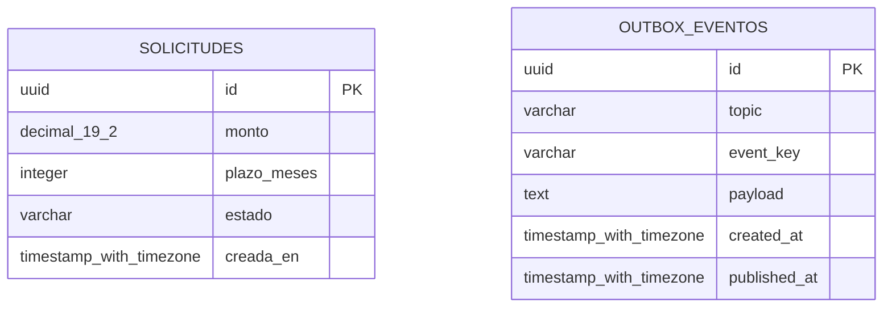
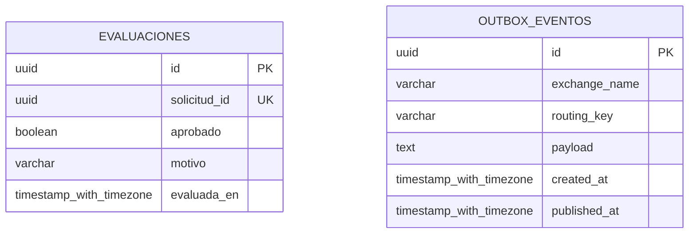
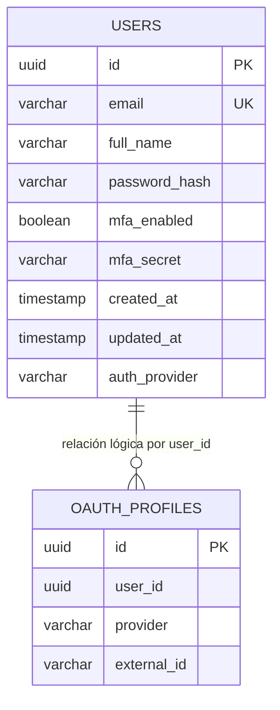

# Modelo de base de datos — Sistema de crédito distribuido

## Principio de distribución

El sistema no usa una única base de datos compartida. Cada microservicio es dueño de su almacenamiento y ninguna consulta debe unir tablas entre servicios.

| Servicio | Base de datos | Motor previsto | Tablas propias |
|---|---|---|---|
| `solicitud-service` | `solicitudes` | PostgreSQL | `solicitudes`, `outbox_events` |
| `evaluacion-service` | `evaluaciones` | PostgreSQL | `evaluaciones`, `outbox_events` |
| `auth-service` | `authdb` | H2 para desarrollo; PostgreSQL recomendado para producción | `users`, `oauth_profiles` |

La relación entre una solicitud y su evaluación se resuelve mediante el evento Kafka `credito.solicitud.creada.v1`, no mediante una clave foránea entre bases de datos.

## 1. Base `solicitudes` — solicitud-service

### Tabla `solicitudes`

| Columna | Tipo lógico | Nulo | Restricción / propósito |
|---|---:|:---:|---|
| `id` | UUID | No | PK; identificador de la solicitud. |
| `monto` | `NUMERIC(19,2)` | No | Importe solicitado. Debe ser mayor que cero en la aplicación. |
| `plazo_meses` | `INTEGER` | No | Plazo solicitado. Debe ser mayor que cero en la aplicación. |
| `estado` | `VARCHAR` | No | Enum persistido como texto. Valor actual: `RECIBIDA`. |
| `creada_en` | `TIMESTAMP WITH TIME ZONE` | No | Instante de creación. |

### Tabla `outbox_events`

| Columna | Tipo lógico | Nulo | Propósito |
|---|---:|:---:|---|
| `id` | UUID | No | PK del evento de salida. |
| `topic` | `VARCHAR` | No | Tópico Kafka; actualmente `credito.solicitud.creada.v1`. |
| `event_key` | `VARCHAR` | No | ID de la solicitud, usado como clave de partición. |
| `payload` | `TEXT` | No | Evento JSON `SolicitudCreadaEvent`. |
| `created_at` | `TIMESTAMP WITH TIME ZONE` | No | Momento de persistencia transaccional. |
| `published_at` | `TIMESTAMP WITH TIME ZONE` | Sí | Se llena al publicar correctamente en Kafka. |

`event_key` representa una relación lógica con `solicitudes.id`; no hay clave foránea porque la outbox es un registro de mensajería y no una entidad de negocio.

## 2. Base `evaluaciones` — evaluacion-service

### Tabla `evaluaciones`

| Columna | Tipo lógico | Nulo | Restricción / propósito |
|---|---:|:---:|---|
| `id` | UUID | No | PK de la evaluación. |
| `solicitud_id` | UUID | No | Único. Identificador recibido desde el evento Kafka. Hace idempotente el consumidor: una solicitud solo se evalúa una vez. |
| `aprobado` | `BOOLEAN` | No | Resultado de la regla de crédito. |
| `motivo` | `VARCHAR` | No | Explicación de la decisión. |
| `evaluada_en` | `TIMESTAMP WITH TIME ZONE` | No | Instante de evaluación. |

`solicitud_id` **no** es una clave foránea física: `solicitudes` pertenece a otra base de datos y a otro servicio.

### Tabla `outbox_events`

| Columna | Tipo lógico | Nulo | Propósito |
|---|---:|:---:|---|
| `id` | UUID | No | PK del evento de salida. |
| `exchange_name` | `VARCHAR` | No | Exchange RabbitMQ: `credito.evaluaciones.v1`. |
| `routing_key` | `VARCHAR` | No | Clave: `evaluacion.completada`. |
| `payload` | `TEXT` | No | Evento JSON `EvaluacionCompletadaEvent`. |
| `created_at` | `TIMESTAMP WITH TIME ZONE` | No | Momento de creación. |
| `published_at` | `TIMESTAMP WITH TIME ZONE` | Sí | Se llena al entregar el evento a RabbitMQ. |

## 3. Base `authdb` — auth-service

### Tabla `users`

| Columna | Tipo lógico | Nulo | Restricción / propósito |
|---|---:|:---:|---|
| `id` | UUID | No | PK generada por JPA. |
| `email` | `VARCHAR` | No | Único; identidad interna de la cuenta. |
| `full_name` | `VARCHAR` | Sí | Nombre mostrado. |
| `password` | `VARCHAR` | Sí | Hash BCrypt; es nulo para cuentas solo OAuth. |
| `mfa_enabled` | `BOOLEAN` | Sí | Indica si la cuenta exige TOTP. Valor inicial `false`. |
| `mfa_secret` | `VARCHAR` | Sí | Secreto TOTP. Debe cifrarse en reposo en producción. |
| `created_at` | `TIMESTAMP` | No | Fecha de creación. |
| `updated_at` | `TIMESTAMP` | Sí | Fecha de última actualización. |
| `auth_provider` | `VARCHAR` | Sí | Enum: `LOCAL`, `GOOGLE` o `GITHUB`. |

### Tabla `oauth_profiles`

| Columna | Tipo lógico | Nulo | Restricción / propósito |
|---|---:|:---:|---|
| `id` | UUID | No | PK generada por JPA. |
| `user_id` | UUID | No | Referencia lógica a `users.id`. |
| `provider` | `VARCHAR` | Sí | Proveedor: `GOOGLE` o `GITHUB`. |
| `external_id` | `VARCHAR` | No | Identificador entregado por el proveedor. |

La restricción única es compuesta: **(`provider`, `external_id`)**. Así, una identidad Google y una GitHub con el mismo valor textual no colisionan.

> El código actual modela `user_id` como referencia lógica, no como una FK física JPA. Para reforzar integridad en producción se recomienda una FK `oauth_profiles.user_id → users.id` dentro de la base `authdb`.

## Índices y reglas recomendados

| Base | Recomendación |
|---|---|
| `solicitudes` | Índice por `creada_en` si se listarán solicitudes por fecha; índice parcial de outbox por `published_at IS NULL`. |
| `evaluaciones` | El índice único de `solicitud_id` ya es obligatorio para idempotencia; índice parcial de outbox por `published_at IS NULL`. |
| `authdb` | Índice único de `users.email`; único compuesto de `oauth_profiles(provider, external_id)`; índice por `oauth_profiles.user_id`. |

El patrón outbox permite que la escritura de negocio y el registro del evento compartan una transacción de base de datos. Por ello, los campos `published_at` deben permanecer nulos hasta que el publicador confirme el envío al broker.
